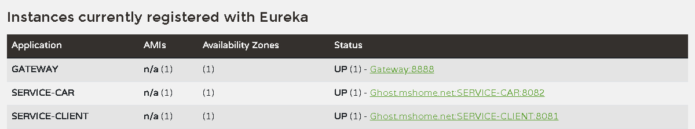
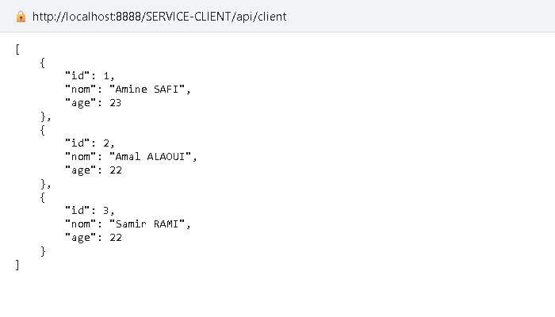
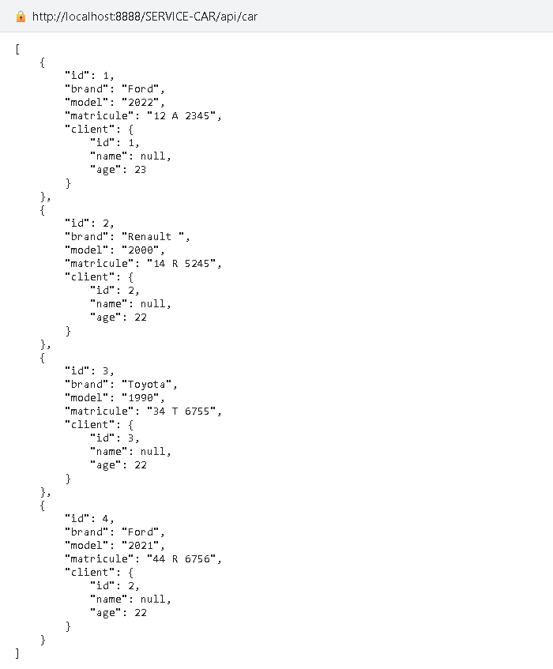

# TP 20 : Architecture Micro-services avec RestTemplate

Architecture composée de 4 projets Spring Boot :

| Projet | Port | Rôle |
|---|---|---|
| `eureka-server` | 8761 | Service discovery Eureka |
| `client-service` | 8081 | Microservice Client (MySQL `clientservicedb`) |
| `gateway` | 8888 | Spring Cloud Gateway (routes dynamiques via Eureka) |
| `car-service` | 8082 | Microservice Voiture (MySQL `carservicedb`) + appel du service Client via RestTemplate |

Ordre de lancement : MySQL → `eureka-server` → `client-service` → `gateway` → `car-service`.

## Résultats

### 1. Tableau de bord Eureka
Les trois microservices GATEWAY, SERVICE-CAR et SERVICE-CLIENT sont enregistrés et au statut UP dans Eureka.

### 2. Service Client via la Gateway
La Gateway route dynamiquement `http://localhost:8888/SERVICE-CLIENT/api/client` vers le service Client et renvoie la liste des clients.

### 3. Service Voiture via la Gateway
`http://localhost:8888/SERVICE-CAR/api/car` renvoie les voitures avec les informations de leur client, récupérées par RestTemplate depuis le service Client.

